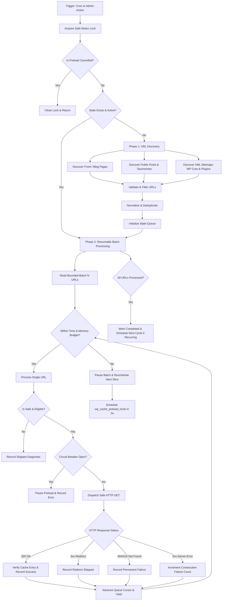

# Turbo Cache — Safe Cache Preload Architecture

## 1. Overview and Problem Statement

The upstream WP Super Cache preload mechanism had several fundamental limitations:
1. **Unbounded or Naive Discovery**: Upstream iterated over published post IDs descending using database query offsets (`LIMIT offset, count`). If posts were published or deleted during a long preload run, the offset shifted, causing duplicate crawls or skipped posts. Upstream had no sitemap discovery support.
2. **Missing Safety Validations**: Upstream performed only basic `wp_cache_is_rejected()` checks. It did not validate the URL host, lacked protection against external URLs or redirects in sitemaps, did not protect WooCommerce sensitive endpoints (Cart, Checkout, My Account, dynamic session endpoints), and did not reject non-cacheable REST/AJAX routes.
3. **No Error Classification or Circuit Breaker**: Upstream blindly called `wp_remote_get()` without inspecting HTTP status codes. It retried 404/410/500 URLs indefinitely, lacked timeout management, and could enter an uncontrolled loop hammering an overloaded server with 5xx errors.
4. **Resource Exhaustion**: Upstream used a 60-second blocking HTTP timeout with arbitrary sleeps. It lacked memory and execution-time bounds per batch slice.
5. **Lossy State Tracking**: Upstream tracked state using temporary files (`taxonomy_*.txt`) and an integer option offset, lacking structured diagnostics, queue resumption, and failure reporting.

Turbo Cache introduces a robust, resource-conscious, and resumable Safe Preload Engine in `inc/preload-engine.php` integrated seamlessly with `inc/preload.php`.

---

## 2. Reused Upstream Functions & Backward Compatibility

To preserve 100% compatibility with existing WP Super Cache hooks, CLI, REST API, and admin UI:

| Upstream Function / Hook | Responsibility & Integration |
|---|---|
| `wpsc_is_preload_active()` | Preserved; returns true if either legacy or Turbo Cache preload is actively processing or mutex-locked. |
| `wpsc_get_preload_status_file_path()` | Preserved; resolves status file location in `$cache_path`. |
| `wpsc_get_preload_status( $include_next )` | Preserved and enriched; returns `{ running, history, next, previous, turbo }` with diagnostic details for admin AJAX polling. |
| `wpsc_update_active_preload( $group, $progress, $url )` | Reused; continuously updates live history for admin UI and JavaScript status notifications. |
| `wpsc_update_idle_preload( $finish_time )` | Reused; transitions state to idle and records completion timestamp. |
| `wpsc_cancel_preload()` | Reused; unschedules cron events, clears mutex, and signals cancellation via stop flag. |
| `wpsc_reset_preload_settings()` | Preserved; cleans mutex, markers, and resets counters. |
| `wpsc_get_post_types()` | Reused; respects `wpsc_preload_post_types_args` and `wpsc_preload_post_types` filters for eligible public post types. |
| `wpsc_post_count()` | Reused; queries total eligible published post count. |
| `wpsc_get_minimum_preload_interval()` | Reused; respects `wpsc_minimum_preload_interval` filter (default 10 minutes). |
| `wp_cache_preload_hook` | Preserved; executes bounded batch slices via WP-Cron. |
| `wp_cache_full_preload_hook` | Preserved; triggers full preload cycle initiation. |
| `wp_cache_is_rejected( $uri )` | Reused; enforces user-defined rejected URI expressions from plugin configuration. |
| `turbo_cache_check_request_safety()` | Integrated; verifies cookie and request safety guards before dispatching or caching. |
| `turbo_cache_detect_woocommerce_cookie()` | Integrated; prevents caching or preloading personalized session states. |

---

## 3. Preload Engine Workflow

---

## 4. URL Discovery & Sitemap Parser

### 4.1 Native Content Discovery
- **Front Page & Blog**: Always includes `home_url( '/' )` and dedicated blog page (`page_for_posts`) if different from front page.
- **Published Content**: Queries public post types using `get_posts()` or direct SQL with `post_status = 'publish'`.
- **Taxonomies**: Tags, categories, and registered public taxonomies.

### 4.2 XML Sitemap Discovery & Parsing
- Sources checked:
  - WordPress Core XML Sitemap: `home_url( '/wp-sitemap.xml' )` (available since WP 5.5).
  - Common SEO Plugin Sitemaps: `home_url( '/sitemap_index.xml' )`, `home_url( '/sitemap.xml' )`.
  - Filterable sitemap list: `apply_filters( 'turbo_cache_preload_sitemap_urls', $urls )`.
- XML Security:
  - External entity loading is strictly disabled (`LIBXML_NONET | LIBXML_NOERROR | LIBXML_NOWARNING`).
  - Strict recursion depth limit (max 2 levels) to handle sitemap index files without infinite recursion.
  - Hard cap on parsed sitemaps (max 20 child sitemaps) and URLs (max 5,000 URLs).
  - Malformed XML or HTTP errors (e.g. 404 on non-existent sitemap) are captured gracefully without terminating discovery.

---

## 5. URL Eligibility & Safety Rules

Every URL discovered from any source must pass `turbo_cache_preload_is_safe_url( $url )`:

1. **Host Verification**:
   - The URL host must strictly match the current site's host (`wp_parse_url( home_url(), PHP_URL_HOST )`).
   - External domains, external CDNs, or foreign IPs are immediately rejected with reason `'external_host'`.
2. **Scheme Verification**:
   - Only `http` and `https` schemes are accepted. Rejects `file:`, `javascript:`, `data:`, `ftp:`.
3. **Path Traversal & Malformed Check**:
   - Rejects directory traversal sequences (`..`), null bytes, or unparseable URLs.
4. **Backend & Admin Blacklist**:
   - Rejects `/wp-admin/`, `wp-login.php`, `wp-register.php`, `xmlrpc.php`, `wp-cron.php`, `wp-app.php`.
5. **REST API & Feeds**:
   - Rejects REST endpoints (`/wp-json/` or `rest_route=`).
6. **WooCommerce Dynamic Endpoints**:
   - Rejects Cart (`wc_get_cart_url()` or `/cart/`).
   - Rejects Checkout (`wc_get_checkout_url()` or `/checkout/` or `/order-received/`).
   - Rejects My Account (`wc_get_endpoint_url()` or `/my-account/`).
   - Rejects WooCommerce API endpoints (`wc-api`, `wc-ajax`, `add-to-cart`).
7. **Query Parameter Bypass**:
   - Rejects parameters that force dynamic generation (`donotcachepage`, `customize_changeset_uuid`, `preview=true`).
8. **User-Configured Rejection Rules**:
   - Respects `wp_cache_is_rejected( $path )` configured in WP Super Cache settings.

---

## 6. Request Generation & Verification

- **Request Dispatch**:
  - Uses `wp_remote_get()` through WordPress's standard HTTP API.
  - Sends dedicated header `X-Turbo-Cache-Preload: 1`.
  - Explicitly sends empty cookies (`'cookies' => array()`), ensuring anonymous, unauthenticated execution without session or cart leaks.
  - Explicit non-caching HTTP client headers (`'Cache-Control' => 'no-cache'`) to request a fresh generation.
  - Bounded request timeout (15 seconds, filterable) preventing worker hangs.
  - No redirect following (`'redirection' => 0`) to prevent infinite redirect loops or unintended external hops.
- **Response Verification**:
  - Validates HTTP response status code.
  - Validates resulting cache entry on disk using `wpsc_supercache_dir_for_url()`.

---

## 7. Bounded Batches, Resumption & Circuit Breaker

1. **Bounded Batching**:
   - Batch size: `WPSC_PRELOAD_POST_COUNT` (default 10, filterable `turbo_cache_preload_batch_size`).
   - Time budget: Max 20 seconds per cron slice (respecting `max_execution_time`).
   - Memory budget: Halts slice if memory reaches 85% of PHP `memory_limit`.
2. **Resumable State**:
   - State stored in `$cache_path . 'preload_state.json'` and backed up in option `turbo_cache_preload_state`.
   - Stores `queue_cursor`: Next cron run immediately resumes at `queue_cursor`, eliminating repeated restarts from index 0.
3. **Circuit Breaker**:
   - Tracks consecutive 5xx errors or connection timeouts.
   - If consecutive failures reach 5, the circuit breaker opens, pausing preload with diagnostic warning.
   - Prevents taking down an overloaded server.
4. **Permanent Failure Cache**:
   - URLs returning 404 Not Found or 410 Gone are registered as permanent failures and will not be retried within the same or subsequent cycles until cache is reset.
5. **Loop Prevention**:
   - Checks `wp_next_scheduled( 'wp_cache_preload_hook' )` before scheduling next slice to guarantee no duplicate cron events.

---

## 8. Telemetry-Free Diagnostics

All diagnostic information is stored locally in `$cache_path . 'preload_state.json'`:
- Status (`idle`, `running`, `paused`, `completed`, `cancelled`).
- Counters: `total_discovered`, `processed`, `cached`, `skipped`, `failed`.
- Skip reasons breakdown (`external_host`, `woocommerce_protected`, `rejected_rule`, `redirected`, `malformed`).
- Failure details (URL, HTTP status code, timestamp, permanent flag).
- Execution timing: `started_at`, `updated_at`, `finished_at`, `elapsed_seconds`.
- Zero external network requests, analytics, or tracking.
